# Distributed Battery Management System

**An extendable, low-cost BMS for second-life EV battery packs.** Need more cells? Just add another
Master Monitoring Unit to the same CAN bus. The current one keeps working and you don't need a bigger BMS.

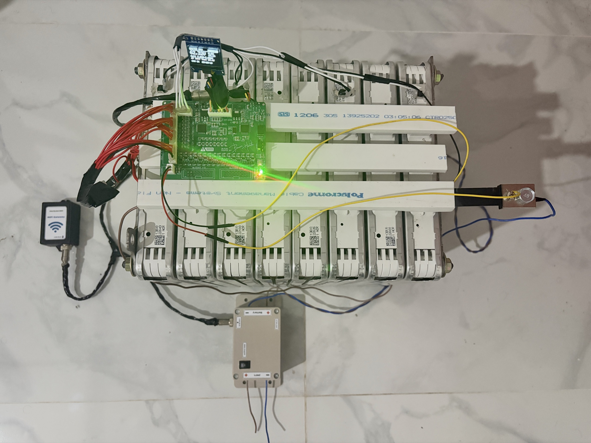 
The complete system on the 16S pack: Master Monitoring Unit with OLED (top), System Controller Unit (bottom) and WiFi Gateway (left).

---

## 1. Project Overview

Old electric-vehicle battery modules still have a lot of useful energy left, so they can get a second life
in home or solar storage. But aged cells are not equal anymore, so every cell has to be watched closely.

**The problem with normal BMSs.** Most low-cost BMSs are *centralized*: one board measures the cells,
protects them, switches the contactors and handles communication. Two things go wrong with that:

- **Fixed cell count.** A 16S BMS can only handle 16 cells. To go to 32S or 64S you have to throw the
  old BMS away and buy a bigger, much more expensive one.
- **Single point of failure.** If that one controller hangs, monitoring and protection are both lost at the same time.

**What this project does differently.** The BMS is split into three kinds of units on one isolated CAN bus:

- **Master Monitoring Unit:** one per 16 cells. It does the measuring, protection and balancing for its own part of the pack.
- **System Controller Unit:** one per system. It switches the contactors.
- **WiFi Gateway:** one per system. It sends all the data to the cloud.

The System Controller Unit and the WiFi Gateway are **separate and shared by every Master Monitoring Unit**.
To make the pack longer (16S → 32S → 48S → 64S), you **connect one more Master Monitoring Unit to the bus.**
The existing hardware stays as it is.

The pack built so far is **16S, made from 8 second-hand Nissan Leaf modules (2S2P each)**. A capacity test showed a
**state of health (SOH) of about 35 %**, so the 66 Ah pack now gives about **23 Ah usable at 60 V nominal**.

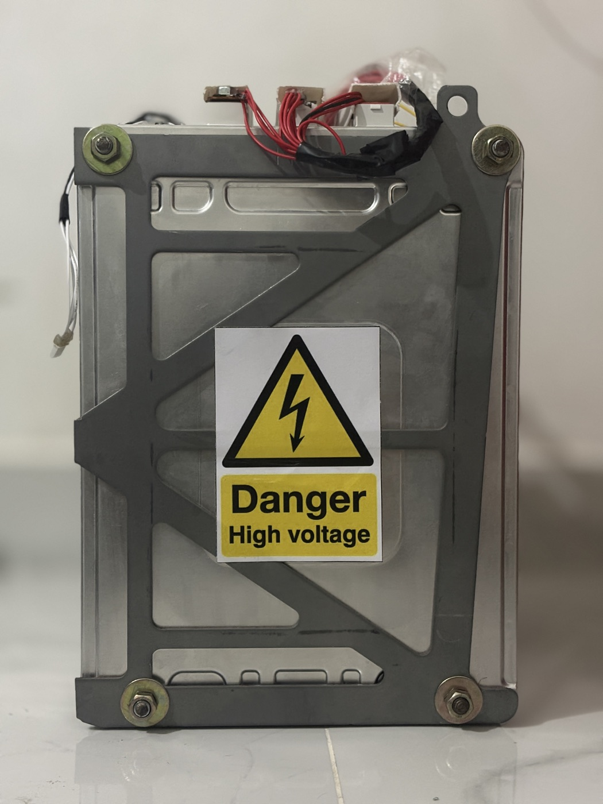
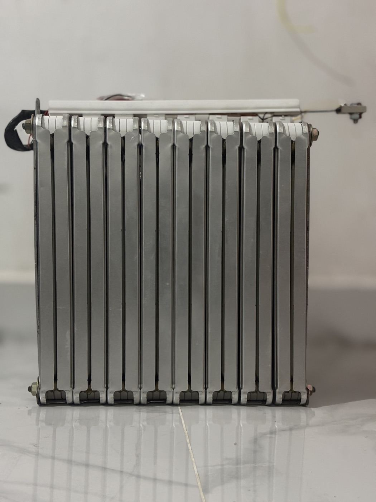

| Unit | Hardware | Job |
| :-- | :-- | :-- |
| **Master Monitoring Unit** | Custom 4-layer PCB: **STM32F103C8T6 + TI BQ76952** | Measures 16 cells, current and 4 temperatures; protection, SoC, balancing, OLED |
| **System Controller Unit** | STM32F103C8T6 (Blue Pill) + ISO1042 module | Precharge, main contactors, charge enable, PWM cooling fan, fail-safe shutdown |
| **WiFi Gateway** | ESP32 DevKit V1 + ISO1042 module | Listens to the whole bus, publishes JSON over MQTT, forwards remote commands |

| Key figures | |
| :-- | :-- |
| Pack | 16S · ≈ 60 V nominal · 3.20–4.10 V per cell working window · ≈ 23 Ah usable |
| Current sensing | 100 A / 75 mV shunt (0.75 mΩ) on the BQ76952 coulomb counter, 10 mA resolution |
| Temperature | 4 × 10 kΩ NTC on the BQ76952 + BQ die temperature |
| Balancing | Passive, 16 × 18 Ω 5 W external bleeders (≈ 0.2 A), NPN drivers on the PCB |
| Bus | Isolated CAN 2.0A, 500 kbit/s, CRC-8 + alive counter on safety frames |
| Update rate | 100 ms measurement and telemetry, 1 s MQTT snapshot |

---

## 2. Why Distributed?

| | Centralized BMS | This distributed BMS |
| :-- | :-- | :-- |
| Going from 16S to 32S or 64S | Buy a new, bigger BMS | Add one Master Monitoring Unit per 16 cells |
| Controller and gateway | Built into the one board | Shared by all units, added only once |
| One controller hangs | Monitoring **and** protection lost | The other units notice and make the pack safe |
| WiFi or cloud goes down | Often affects the whole board | Protection keeps running; data is buffered and sent later |

**How a bigger pack fits on the same bus**
- **Works at any height in the stack:** each Master Monitoring Unit has its own isolated CAN transceiver and isolated
  power supply, so it can sit at any voltage level of the stack.
- **No message clashes:** each unit is planned to get its own block of CAN IDs, so up to four units (64S) can share one bus.
  Even at that size the bus is far from full.
- **No changes to the shared units:** the System Controller Unit and the WiFi Gateway tell the units apart by their IDs, so
  they don't need new hardware.

**How no single failure leaves the pack unprotected**
- **A Master Monitoring Unit goes silent:** this could be a broken wire or frozen firmware. The System Controller Unit misses
  its heartbeat and opens all contactors within **500 ms**, and the watchdog restarts the frozen unit.
- **The System Controller Unit loses power:** the contactors drop open by themselves. The Master Monitoring Units keep
  measuring and showing the data.
- **The WiFi Gateway or the internet fails:** protection is not affected at all. The gateway keeps 5 minutes of data and
  sends it once it reconnects.
- **A message gets corrupted on the bus:** the CRC-8 check rejects it, and frozen data is caught by the alive counter.

> **Current status:** the hardware built so far is one 16S Master Monitoring Unit. The firmware in this repository runs
> that single unit.

---

## 3. Core Functionalities

**Sensing and protection (Master Monitoring Unit)**
- Reads all 16 cell voltages, the stack voltage and the pack current **every 100 ms**, plus 4 NTCs and the BQ76952 chip temperature.
- **Two protection layers:**
  - the BQ76952's own hardware limits (over/under voltage, over-current, short circuit, over/under temperature);
  - software checks on the STM32.
- Detects **sensor faults**, not only battery faults: a broken cell-sense wire, an open or shorted NTC, or a lost link to the BQ76952.
- **Faults stay latched** until someone clears them **and** the problem is really gone. A clear command can never override a live danger.
- **Tells the rest of the system how much current is allowed** for charging and discharging. The limit is lowered near
  full / empty and when the cells get hot (45 → 55 °C).

**State of charge**
- Starts from the resting cell voltage and then counts every coulomb with the BQ76952's hardware counter.
- Corrects itself again after 30 minutes of rest.
- Reports SoC, SoH, remaining Ah and usable capacity.

**Balancing**
- **Passive balancing** through external 18 Ω / 5 W resistors driven by transistors on the PCB.
- Neighbouring cells take turns (odd / even every 30 s).
- A cell bleeds only when it is more than 25 mV above the lowest cell, the pack is above 3.85 V per cell, cooler than
  45 °C and not discharging.

**Power control (System Controller Unit)**
- **Safe start (precharge):** a small precharge relay first charges the load capacitors slowly. The main contactor closes
  only after the current has dropped below 1 A. This avoids a big spark and welded contacts.
- **Opens every contactor at once** on any fault, a missing heartbeat, corrupted data, the E-stop or too much current.
- **Never restarts by itself:** after a fault or a remote stop, the key must be turned OFF and ON again.
- **Cooling fan** speed follows the hottest cell (30 → 45 °C). It runs at 40 % while balancing and at 100 % if temperature data is lost.

**Cloud link (WiFi Gateway)**
- Listens to every message on the bus and sends **one JSON snapshot per second** over MQTT, with real time stamps.
- **Store & forward:** keeps 5 minutes of data when WiFi is down and sends it later.
- Sends fault and state-change events, and accepts **remote commands checked with a token**: clear faults, balancing
  on/off, stop, fan speed.
- The remote side can **stop** the pack but can never close a contactor.

**Web dashboard**
- Live pack data in the browser **once every second**: voltage, current, SoC, all 16 cells, temperatures, contactors,
  fan and balancing.
- **History charts** from 1 hour to 30 days, with CSV export.
- **Automatic alarms** from the fault bits.
- **Remote commands** with a full log.
- **Admin and viewer accounts.**
- Works on phones too.

**Local display:** a 0.96" OLED on the Master Monitoring Unit shows a summary, the cell voltages (bleeding cells
highlighted), temperatures and faults. Both STM32 units also have a serial command line for testing.

---

## 4. System Requirements

**Functional**

| ID | Requirement |
| :-- | :-- |
| FR1 | Measure 16 cell voltages (1 mV), stack voltage, pack current (±266 A range) and 4 cell temperatures every 100 ms per Master Monitoring Unit |
| FR2 | Detect and latch cell OV/UV, over/under temperature, charge/discharge over-current, short circuit, imbalance and sensor faults |
| FR3 | Estimate SoC and report SoH, remaining capacity and allowed charge / discharge current |
| FR4 | Balance cells passively through external bleeders, never two neighbouring cells at once |
| FR5 | Show live pack data and faults on the Master Monitoring Unit OLED |
| FR6 | Exchange all data over isolated CAN with one message map shared by every unit |
| FR7 | The System Controller Unit controls precharge, main contactors, charge enable and the cooling fan, and opens all relays on any fault |
| FR8 | The WiFi Gateway publishes time-stamped telemetry to MQTT every second and forwards authorised remote commands |
| FR9 | The web dashboard shows live data, history, alarms and remote commands, with separate admin and viewer roles |
| FR10 | More Master Monitoring Units can be added to extend the pack in steps of 16 cells, sharing one System Controller Unit and one WiFi Gateway |

**Non-functional**

| ID | Requirement | How it is met |
| :-- | :-- | :-- |
| NFR1 | Fail-safe | Relays open at reset and on any fault; the System Controller Unit trips 500 ms after the last heartbeat; watchdog on both STM32 units |
| NFR2 | Galvanic isolation | Pack side and system side separated by ISO1042 (5 kVrms) and a B0505S isolated DC-DC |
| NFR3 | Data integrity | CRC-8 (SAE J1850) + alive counter on status / pack / limits / commands; frozen or corrupt data is rejected |
| NFR4 | Timing | 100 ms control cycle, status frame sent immediately on any change, 2.7 % bus load for one unit |
| NFR5 | Availability | Gateway buffers ≥ 5 min of data offline and reconnects on its own |
| NFR6 | Security | Credentials kept out of git, command token, optional TLS, dashboard login with roles; the remote side can **stop** the pack but can never close a contactor |
| NFR7 | Scalability | No single point of failure; adding a unit needs no new hardware in the System Controller Unit or the WiFi Gateway |
| NFR8 | Resources | Fits an STM32F103C8 (64 KB / 20 KB): Master Monitoring Unit uses 31 KB / 6.7 KB, System Controller Unit 17 KB / 4.9 KB |

---

## 5. System Architecture

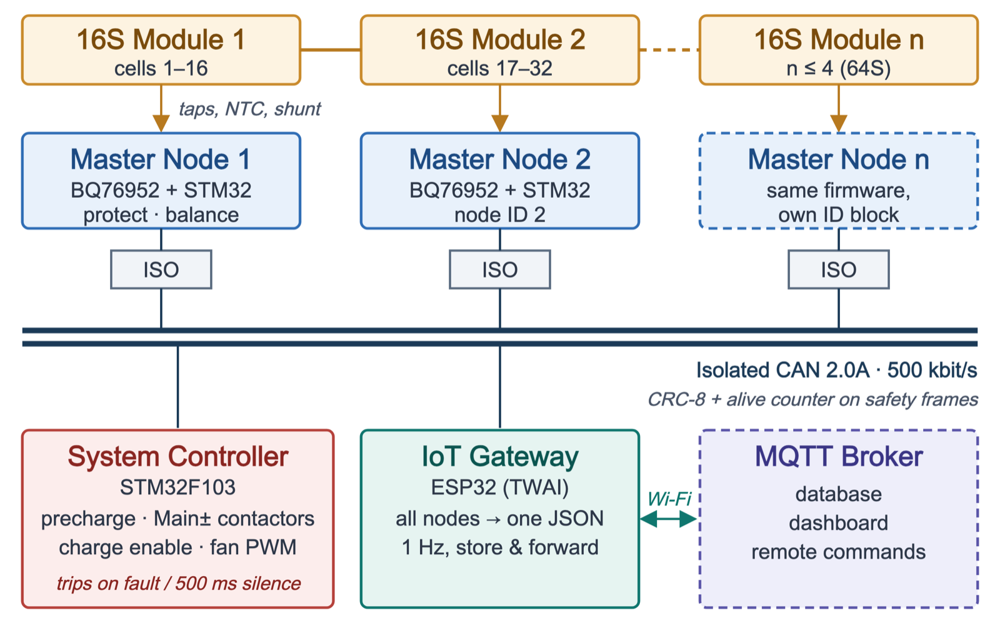

- **Isolated on every unit:** each Master Monitoring Unit sits at its own place in the stack and talks to the rest of the
  system only through isolated CAN and an isolated power supply. The pack side and the low-voltage side never share a ground.
- **Shared units:** the System Controller Unit and the WiFi Gateway sit on the same bus and serve every unit.
- **Four safety layers:**
  1. BQ76952 hardware limits;
  2. software checks on the Master Monitoring Unit;
  3. the System Controller Unit opens the contactors;
  4. watchdogs and CRC checks catch frozen units or bad data.

### How the System Controller Unit switches the pack

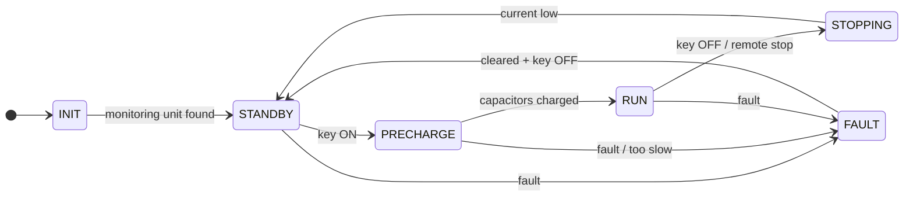

| State | What happens |
| :-- | :-- |
| STANDBY | All contactors open, waiting for the key |
| PRECHARGE | Load capacitors charge slowly through a resistor |
| RUN | Main contactors closed, pack is in use |
| STOPPING | Waits for the current to fall, then opens the contactors |
| FAULT | Everything open; needs the fault cleared and the key turned OFF → ON |

---

## 6. Hardware: Master Monitoring Unit

Designed in **EasyEDA**: 4 layers, **92.3 × 71.5 mm**, 162 parts. The bare boards were **fabricated by JLCPCB**
(Gerbers, BOM and pick-and-place in [`PCB/`](PCB/)).

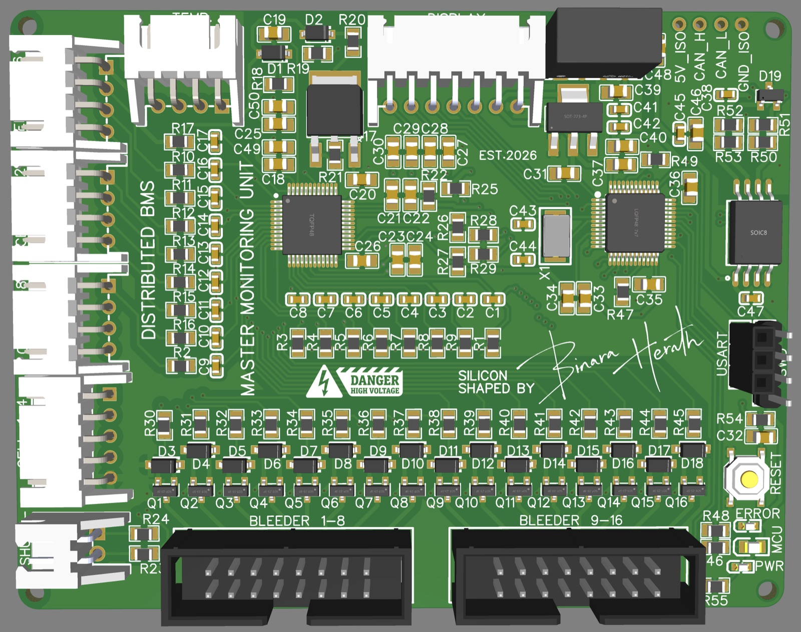 
3D view: cell and shunt connectors on the left, bleeder headers at the bottom, isolated CAN connector at the top right.

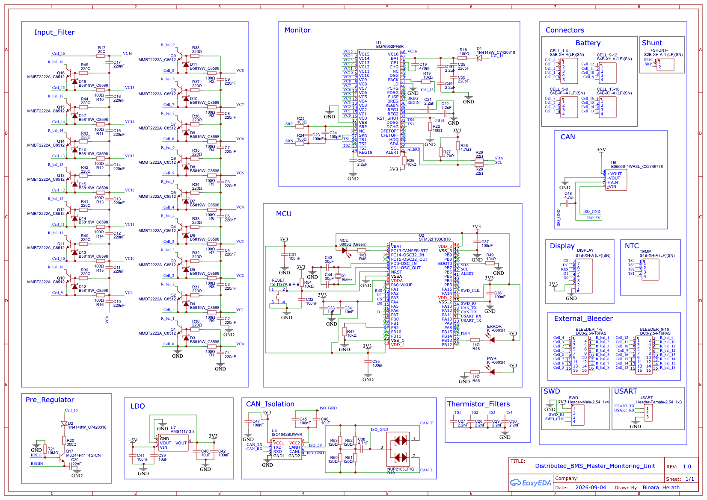 
Schematic: cell input filters and bleeder drivers, BQ76952, STM32, isolated CAN (ISO1042 + B0505S), LDO, OLED, NTC, SWD and USART headers.

| Top | Inner 1 |
| :-: | :-: |
| 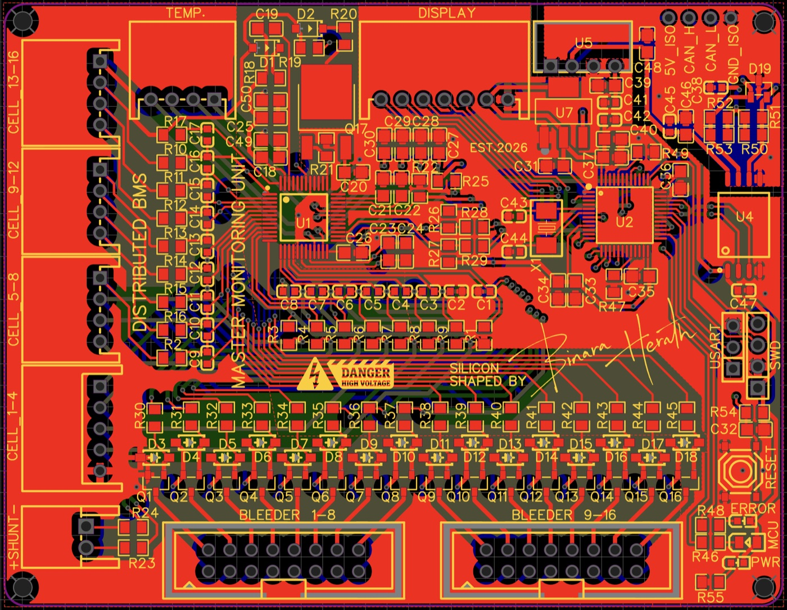 | 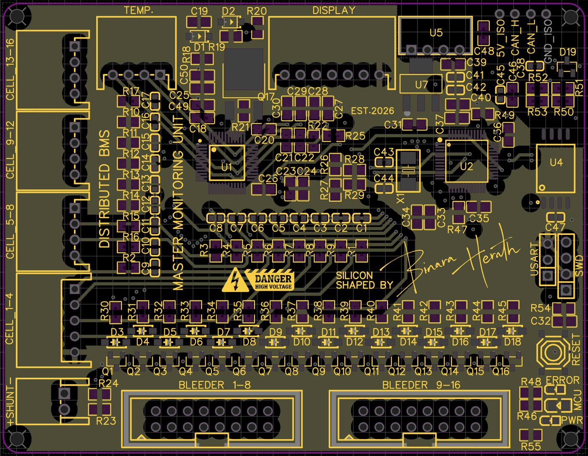 |
| Parts and most of the routing | Ground plane + short routes |
| **Inner 2** | **Bottom** |
| 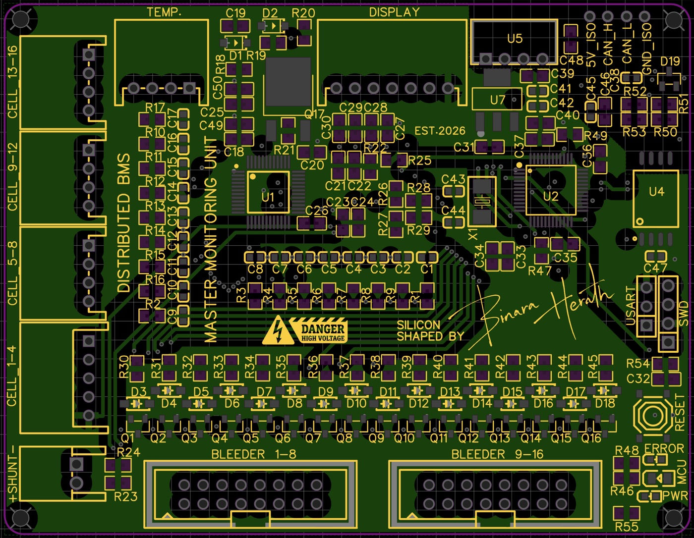 | 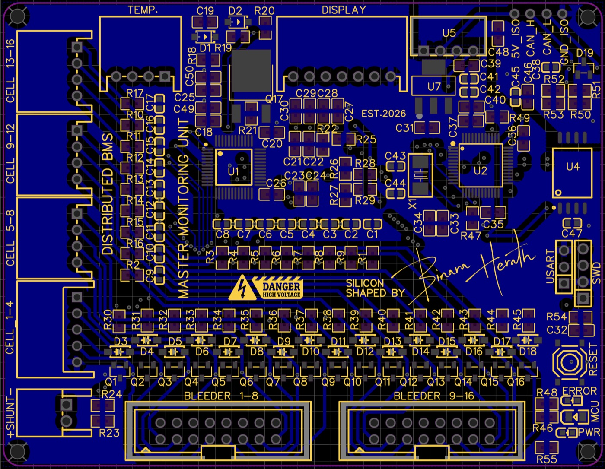 |
| Ground plane + short routes | GND / isolated GND pour + routes |

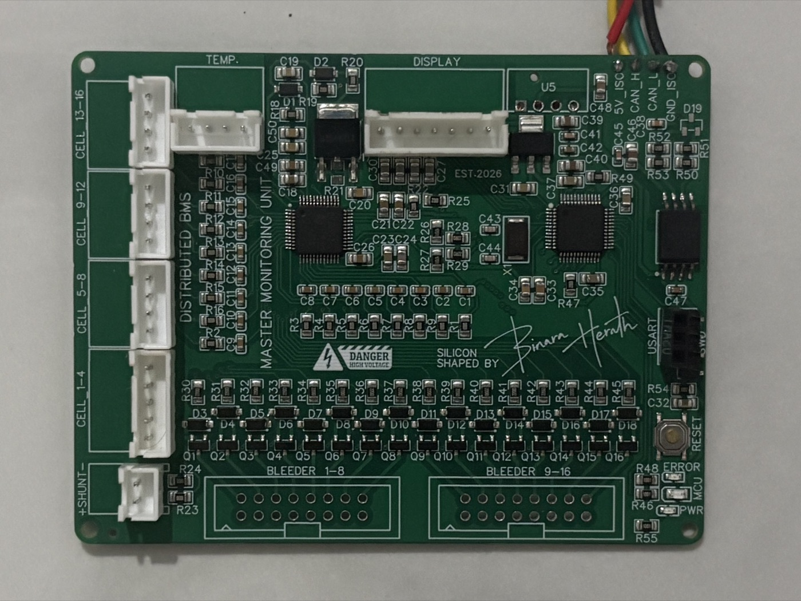 
The assembled board.

**Design points**
- **Cell inputs:** all 17 cell-sense lines are filtered (100 Ω / 220 nF). Each cell has its own transistor driver for the external bleeder resistor.
- **Current sense:** the shunt input has a differential filter for clean readings.
- **Safe BQ76952 reset:** the reset pin is controlled by the MCU with a short pulse, so the chip can never be shut down by accident.
- **CAN and power connector:** split 120 Ω CAN termination and ESD protection. One 4-pin connector carries 5 V, CAN_H, CAN_L and GND.

<table>
<tr>
<td align="center" width="50%">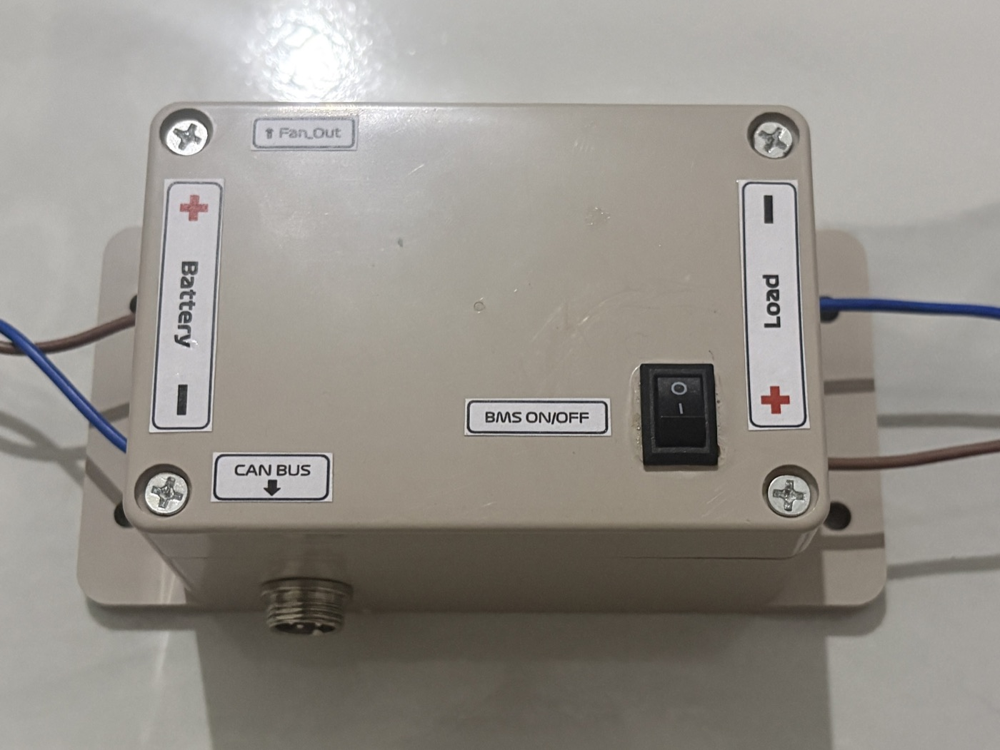 System Controller Unit</td>
<td align="center" width="50%">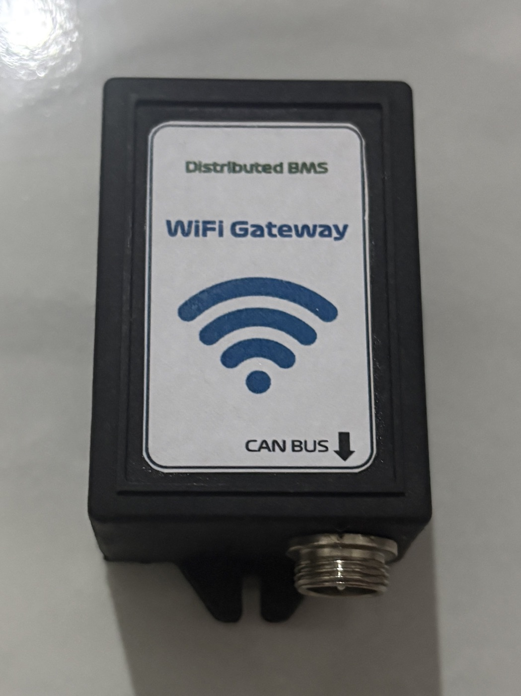 WiFi Gateway</td>
</tr>
</table>

---

## 7. Dashboard

The dashboard runs on any computer with Docker and opens in the browser, including on a phone on the same WiFi.
- **Overview:** the pack at a glance. You see SoC, voltage, current and power, the charge and discharge limits, a live
  drawing of the contactors, the temperatures, how far each cell is from the average, and the health of every unit.
- **Cells:** all 16 cell voltages in detail, with the balancing cells shown.
- **History:** charts over any time range, with CSV export.
- **Alarms:** every fault with when it started and ended. An admin can acknowledge it.
- **Control:** clear faults, balancing on/off, fan speed and stop. Each command is logged until the pack confirms it.
- **Settings:** pack details and user accounts.

**Every value shows where it came from:** *Live* (measured from the pack), *Simulated* or *Offline*.
A demo simulator can run as a separate pack, so you can show the dashboard without the battery, and simulated data
is never mixed with the real pack's data.

Details and setup: [`Software/README.md`](Software/README.md).

---

## 8. Technology Stack

| Area | Used in this project |
| :-- | :-- |
| Microcontrollers | STM32F103C8T6 (Cortex-M3, 72 MHz) × 2 · ESP32-WROOM-32 (DevKit V1) |
| Battery front end | TI BQ76952 (16S AFE, coulomb counter, HW protection, balance switches) |
| Isolation and bus | TI ISO1042 isolated CAN FD transceiver (custom modules + on-board) · Mornsun B0505S · NUP2105 ESD |
| Other parts | AMS1117-3.3 · MJD44H11 pre-regulator · MMBT2222A + B5819W bleeder drivers · 0.96" SSD1306 OLED |
| PCB | **EasyEDA** (schematic + 4-layer layout) · JLCPCB fabrication |
| STM32 firmware | C11 · STM32 HAL (Cube FW_F1 1.8.7) · STM32CubeMX 6.18 · CMake + Ninja · arm-none-eabi-gcc |
| ESP32 firmware | C++17 · Arduino-ESP32 2.0 (ESP-IDF TWAI driver, FreeRTOS) · PlatformIO · PubSubClient · ArduinoJson 7 |
| Protocols | CAN 2.0A · I²C · SPI · UART · MQTT 3.1.1 · JSON · NTP · TLS (optional) |
| Tools | VS Code + STM32Cube extension · Cortex-Debug / OpenOCD · ST-Link V2 · host tests with clang/gcc |
| Data and dashboard | Eclipse Mosquitto · Spring Boot (Java 21) · PostgreSQL · React + TypeScript · Docker Compose |

---

> ⚠️ **Safety:** this pack stores more than a kWh at 60 V. Test new firmware with the contactors disconnected or on a
> current-limited supply first, keep an E-stop in the loop, and never bypass the BQ76952 hardware protections.

**Author:** Binara Herath · 2026
