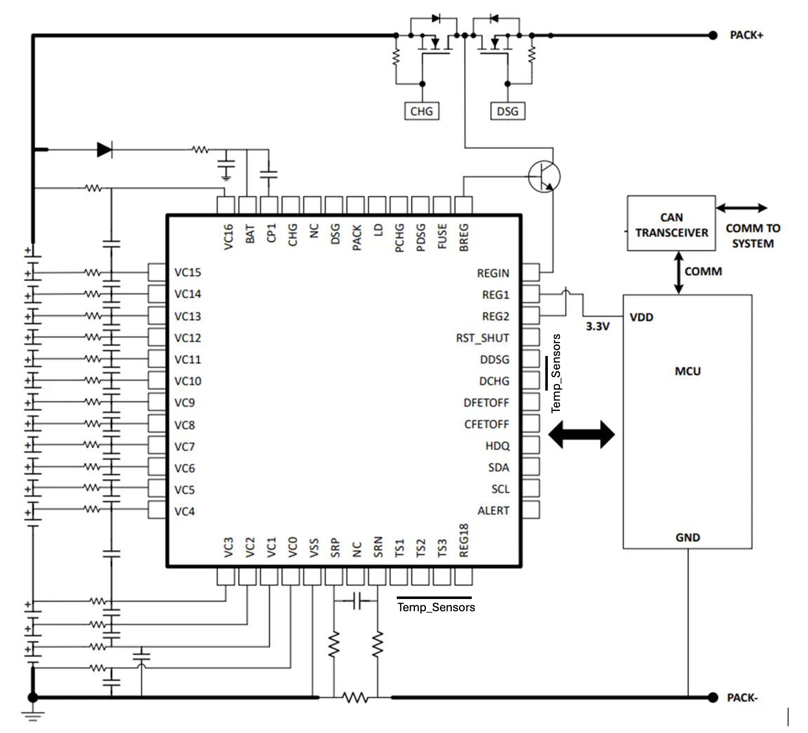
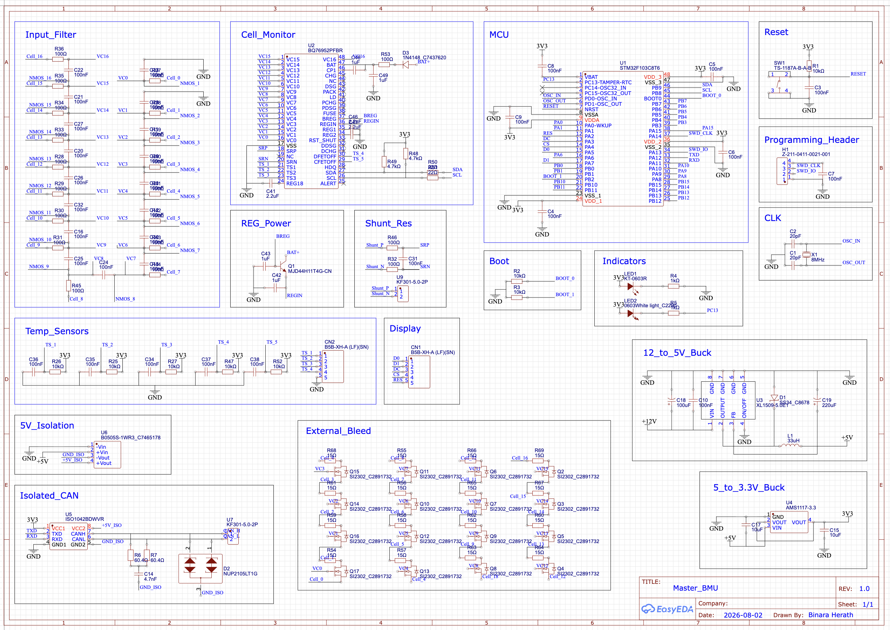

# Distributed AI-Enhanced 16S Battery Management System

## Project Overview
This repository contains the firmware, network architecture, and cloud telemetry pipeline for a distributed 16S Battery Management System. Designed strictly around **Embedded Computer Networks and Software-Hardware Co-development**, this project solves complex battery management challenges using distributed computing nodes, isolated communication buses and software-controlled logic rather than pure analog circuitry.

The system is designed to scale from standard 18650 cell packs up to pouch cells (Nissan Leaf modules) and prismatic cells, leveraging a Master-Satellite topology to separate sensing, actuation, and cloud telemetry.

---

## Core Functionalities

1. **Distributed Data Acquisition:** The system reads 16 individual cell voltages, pack current and temperatures at the battery edge and transmits this data across a secure, priority-mapped network.
2. **Software-Controlled Passive Balancing:** Cell voltage deltas are calculated by the Master BMU, which dynamically commands the analog front-end to trigger external P-Channel MOSFETs and bleed resistors on a per-cell basis.
3. **Fail-Safe Power Distribution:** An independent Auxiliary node physically controls main charge/discharge contactors and thermal management systems based on network commands, providing physical isolation from the measurement logic.
4. **Edge-to-Cloud Telemetry Pipeline:** A dedicated IoT gateway sniffs local bus traffic, serializes the embedded data into JSON payloads, and pushes it to a cloud database via MQTT/Wi-Fi.
5. **AI-Driven State of Health (SOH) Monitoring:** Cloud-hosted Python backend scripts apply a Scikit-Learn machine learning model (trained on NASA Battery Datasets) to historical telemetry to predict battery degradation, visualized on a live Grafana dashboard.

---

## System Requirements

### Functional Requirements
* **FR1 - Cell Measurement:** Node 1 must measure up to 16 series cell voltages, aggregate pack current via a shunt, and read thermistor data using the TI BQ76952 AFE.
* **FR2 - Balancing Actuation:** Node 1 must calculate cell voltage imbalances and transmit I2C commands to the AFE to toggle external passive balancing circuits.
* **FR3 - Network Communication:** All nodes must communicate over a CAN 2.0B bus using standard 11-bit identifiers with predefined priority mapping.
* **FR4 - Contactor Control:** Node 2 must parse incoming CAN messages to control standard charge/discharge relays and precharge sequences.
* **FR5 - Telemetry Forwarding:** Node 3 must operate in CAN promiscuous mode to capture all bus traffic, format it into JSON, and transmit it to an external MQTT broker.

### Non-Functional Requirements
* **NFR1 - Galvanic Isolation:** The CAN bus must utilize isolated CAN transceivers to protect the microcontrollers from the 60V battery ground.
* **NFR2 - Microsecond Fault Response:** Node 1 must utilize hardware-level external interrupts tied to the AFE's ALERT pin to trigger immediate safety routines during short-circuit events.
* **NFR3 - Network Safety:** Node 2 must implement a software watchdog/heartbeat monitor. If network communication from Node 1 is lost, Node 2 must default to a safe state (drop all contactors) to prevent thermal runaway.
* **NFR4 - Scalability:** The network architecture must allow the addition of a second Master BMU (scaling to 32S) without requiring changes to the IoT Gateway or Aux Controller firmware.

---

## System Architecture

The project is built on a 3-node distributed architecture communicating over an **Isolated CAN 2.0B bus**:

* **Node 1: Master BMU (Sensing & Balancing)**
    * **Hardware:** STM32 + TI BQ76952 AFE.
    * **Function:** Sits directly on the battery pack. Executes software-controlled balancing and triggers hardware interrupts for short-circuit protection.
* **Node 2: Aux Controller (Power Distribution)**
    * **Hardware:** STM32.
    * **Function:** Listens to CAN traffic via Hardware Acceptance Filtering. Controls charge/discharge contactors and thermal management. 
* **Node 3: IoT Gateway (Telemetry & Edge-to-Cloud)**
    * **Hardware:** ESP32.
    * **Function:** Sniffs bus traffic, serializes telemetry into JSON, and publishes to an MQTT broker over Wi-Fi.

---


## Weekly Development Timeline

| Week | Phase | Tasks & Deliverables | Syllabus Mapping | Status |
| :--- | :--- | :--- | :--- | :--- |
| **Week 1** | **System Formulation** | Finalize the 16S distributed BMS architecture, define the three-node architecture, evaluate STM32/ESP32/BQ76952, and define the isolated CAN network topology. | 1. Project Formulation | ✅ Completed |
| **Week 2** | **Requirements & Planning** | Define functional and non-functional requirements, communication requirements, fault-handling strategy, hardware/software interfaces, and development plan. Initialize project repository and documentation. | 2. Project Plans <br> 3. Requirement Engineering | ✅ Completed |
| **Week 3** | **System Architecture & Firmware** | Define CAN message structure, node responsibilities and data flow. Develop the initial STM32 firmware architecture and BMS data-handling framework. | 4. High-level Simulation <br> 5. Architecture Extension | ✅ Completed |
| **Week 4** | **Node 1 Firmware & BMS Interface** | Develop STM32–BQ76952 I²C communication, cell-monitoring firmware, temperature/current data acquisition, and external passive balancing control. | 5. Architecture Extension <br> 6. Prototype Development | 🔄 In Progress |
| **Week 5** | **CAN Communication Prototype** | Develop and test CAN communication between STM32 and ESP32. Design and assemble custom ISO1042-based CAN transceiver modules with termination. Implement CAN data transmission and reception. | 6. Prototype Development | ✅ Completed |
| **Week 6** | **IoT Gateway & Hardware Prototype** | Develop ESP32 CAN gateway firmware and basic Wi-Fi monitoring interface. Assemble the breadboard testing setup using STM32 Blue Pill, ESP32, BQ76952 SMD-to-DIP adapter, and custom CAN modules. Complete the Node 1 schematic. | 6. Prototype Development | ✅ Completed |
| **Week 7** | **Battery Pack & Full Hardware Prototype** | Prepare the 16S Nissan Leaf battery pack and complete the full BMS testing circuit on dot board. Integrate cell-voltage, current and temperature sensing, balancing, and CAN communication with the battery pack. | 6. Prototype Development | 🔄 In Progress |
| **Week 8** | **Node 1 PCB Development** | Complete PCB routing and design verification for Node 1. Review power, sensing, I²C, CAN isolation, balancing, and connector interfaces. Prepare PCB for fabrication. | 6. Prototype Development | 🔄 In Progress |
| **Week 9** | **Backend & Data Infrastructure** | Develop the backend communication layer. Implement MQTT communication, telemetry processing, and database integration for cell-level and pack-level measurements. | 6. Prototype Development | ⏳ Planned |
| **Week 10** | **Dashboard & Visualization** | Develop the user interface for real-time monitoring. Display individual cell voltages, pack voltage, current, temperatures, balancing status, SOC, and fault information. | 6. Prototype Development | ⏳ Planned |
| **Week 11** | **Node 2 System Control** | Integrate and test the second STM32 node for precharge control, charge/discharge contactors, PWM cooling fan, and system-level fault response. Implement heartbeat/watchdog-based communication monitoring. | 6. Prototype Development | ⏳ Planned |
| **Week 12** | **Custom PCB & System Integration** | Assemble and test the custom Node 1 PCB. Integrate Node 1, Node 2, and ESP32 gateway through the isolated CAN network. Finalize firmware and communication protocols. | 7. Integrated Testing | ⏳ Planned |
| **Week 13** | **System Validation & Performance Testing** | Perform integrated testing with the battery pack. Evaluate cell-voltage measurement accuracy, temperature/current sensing, CAN communication, balancing, fault handling, contactor/precharge operation, and communication failure response. | 7. Integrated Testing <br> 8. Production Environment | ⏳ Planned |
| **Week 14** | **Finalization & Demonstration** | Complete enclosure and physical integration, finalize dashboard, documentation, and test results. Conduct final system demonstration and prepare the project presentation and required artefacts. | 9. Artefacts <br> 10. Presentation | ⏳ Planned |

---

## 🛠️ Technology Stack

**Embedded Hardware:**
* Microcontrollers: STM32, ESP32
* Networking: CAN Transceivers
* PCB Design: EasyEDA

**Embedded Software:**
* Firmware: C/C++, FreeRTOS, STM32 HAL
* Protocols: CAN 2.0B, I2C, UART, MQTT

**Cloud & AI Backend:**
* Broker: Eclipse Mosquitto (MQTT)
* Database: InfluxDB
* Dashboard: Grafana
* ML Pipeline: Python

```mermaid
flowchart TD
    subgraph Battery Level
        Pack[16S Battery Pack & Thermistors]
    end

    subgraph Distributed BMS Nodes
        Node1[Node 1: Master BMU<br>STM32 + BQ76952 AFE]
        Node2[Node 2: Aux Controller<br>STM32]
        Node3[Node 3: IoT Gateway<br>ESP32]
        CAN{Isolated CAN 2.0B Bus}
    end

    subgraph Power & Actuation
        Relays[Charge/Discharge Contactors<br>& Thermal Management]
    end

    subgraph Cloud & AI Backend
        MQTT[MQTT Broker]
        DB[(InfluxDB)]
        ML[Python AI SOH Model]
        Dash[Grafana Dashboard]
    end

    Pack <-->|Analog| Node1
    Node1 <-->|Telemetry & Commands| CAN
    CAN <--> Node2
    CAN <--> Node3
    
    Node2 -->|Physical Control| Relays
    Node3 -->|Wi-Fi / JSON| MQTT
    
    MQTT --> DB
    DB <--> ML
    DB --> Dash
