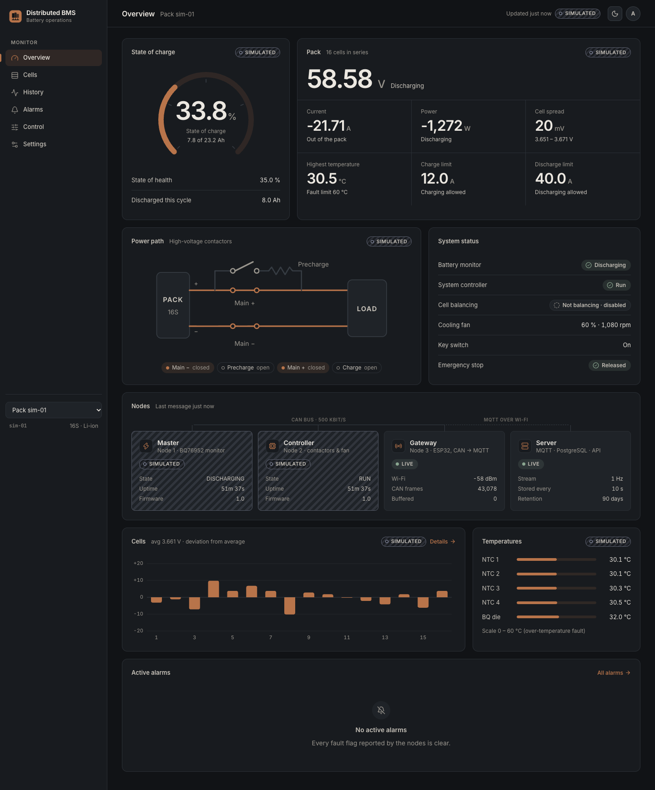
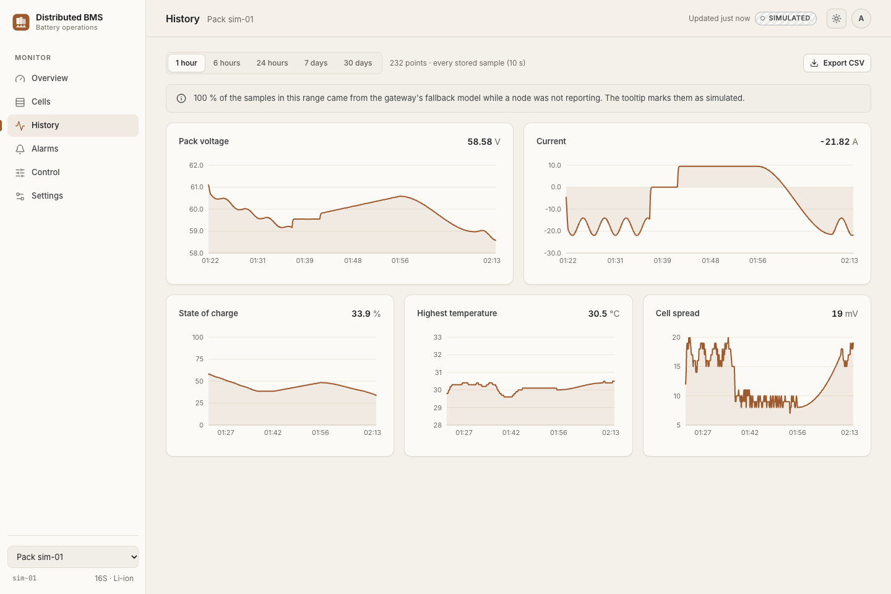
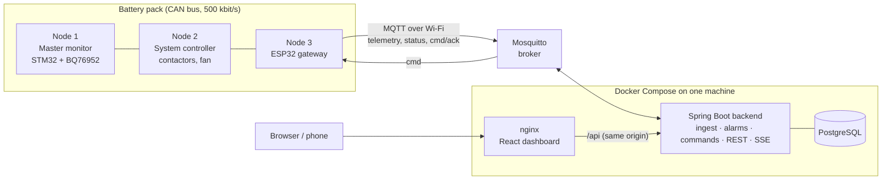
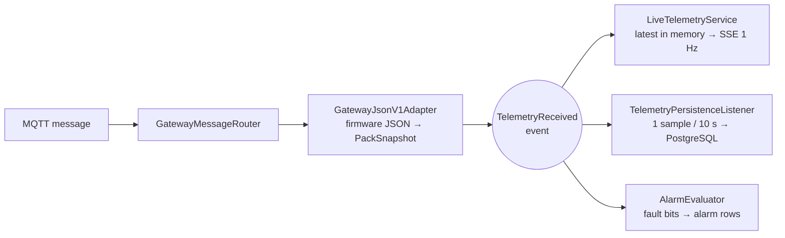

# Distributed BMS – Software

Server, database and dashboard for the distributed battery management system in this
repository. The three nodes (master monitor, system controller, ESP32 gateway) live in
[`../Firmware`](../Firmware). This folder holds everything above the gateway: it
receives the gateway's MQTT data, stores it, raises alarms, relays remote commands and
shows it all on a live web dashboard for desktop and phone.



*Overview page fed by the gateway simulator, which is why the nodes carry "Simulated" tags.*

## What it does

- **Live view at 1 Hz** – pack voltage, current, power, state of charge, 16 cell
  voltages, 4 temperatures, contactor states, fan, balancing and node health, pushed
  to the browser with Server-Sent Events.
- **Provenance on every number** – each node is shown as *Live* (measured), *Simulated*
  (the gateway is filling in for a silent node) or *Offline*. Simulated data is never
  shown as real.
- **History** – one sample every 10 s with all cell voltages and temperatures, charts for
  1 hour to 30 days (averaged into 1 min or 15 min buckets for long ranges), CSV export.
- **Alarms** – raised and cleared automatically from the fault bits the nodes report,
  filterable, paginated and acknowledged by an administrator.
- **Remote commands** – balancing on/off, fan override, clear faults, stop. Every
  command is logged and followed to its end state (accepted, rejected or timed out).
- **Two roles** – administrators control the pack and manage users; viewers can only look.
- **Light and dark theme**, responsive from a 390 px phone to a wide monitor.



## Architecture



Inside the backend, one incoming MQTT message goes through these steps:



The backend is one deployable, organised **by feature** (`ingest`, `telemetry`, `alarm`,
`command`, `pack`, `user`, `auth`), and each feature is layered controller → service →
repository. Two design patterns are used where they solve a real problem:

| Pattern | Where | Why |
|---|---|---|
| **Adapter** | `GatewayJsonV1Adapter` | The only class that knows the firmware's JSON field names and units. A future multi-master payload needs a new adapter, not changes everywhere. |
| **Observer** | Spring events: `TelemetryReceived` → three listeners | Live view, storage and alarms react to the same message without knowing about each other; one failing listener does not stop the others. |

Remote commands use plain polymorphism: one small class per command type knows its
argument rules and its JSON form (`CommandDefinitions`).

## Tech stack

| Layer | Technology |
|---|---|
| Backend | Java 21, Spring Boot 4 (Web MVC, Data JPA, JDBC, Security, Validation, Actuator), Flyway, Eclipse Paho MQTT, springdoc-openapi |
| Database | PostgreSQL 16 |
| Messaging | Eclipse Mosquitto 2 (password file + per-user ACL) |
| Frontend | React 19, TypeScript, Vite, React Router, TanStack Query, Recharts, Radix UI primitives, CSS Modules |
| Tests | JUnit 5, AssertJ, Mockito, Testcontainers, MockMvc · Vitest, Testing Library |
| Delivery | Docker Compose, GitHub Actions |

## Run it

Needs Docker Desktop (or Docker Engine with Compose).

```bash
cd Software
cp .env.example .env          # then change every password in .env
docker compose up -d --build  # dashboard on http://localhost:8080
```

Sign in with the admin or viewer account from `.env`. Phones on the same Wi-Fi open
`http://<computer-name>.local:8080`. No hardware yet? Start the simulator too:

```bash
docker compose --profile sim up -d     # publishes as gateway "sim-01"
```

### Development without containers for the code

```bash
docker compose up -d postgres mosquitto           # only the infrastructure
cd backend && ./mvnw spring-boot:run              # API on :8081
cd frontend && npm install && npm run dev         # UI on :5173, proxies /api to :8081
python3 tools/gateway-simulator/simulator.py      # optional; --help lists the options
```

## API

Interactive documentation (OpenAPI / Swagger UI) is served at **`/api/docs`**.
Errors use the RFC 9457 `application/problem+json` format everywhere.

| Method and path | Role | Notes |
|---|---|---|
| `POST /api/v1/auth/login` · `POST /logout` · `GET /me` | – | Session in an httpOnly, SameSite=Strict cookie |
| `GET /api/v1/packs` · `GET /{id}` · `PATCH /{id}` | any · any · admin | Packs register themselves on their first message |
| `GET /api/v1/packs/{id}/telemetry/latest` | any | `204` until the gateway has reported |
| `GET /api/v1/packs/{id}/stream` | any | Server-Sent Events: `telemetry` (1 Hz), `heartbeat` (3 s) |
| `GET /api/v1/packs/{id}/telemetry?from&to` | any | Resolution picked from the range; `400` above 31 days |
| `GET /api/v1/packs/{id}/cells/{n}/history` | any | One cell over time |
| `GET /api/v1/packs/{id}/telemetry/export` | any | CSV with every cell voltage |
| `GET /api/v1/packs/{id}/alarms?status&severity&page&size` | any | Paginated, newest first |
| `PATCH /api/v1/alarms/{id}` | admin | `{"acknowledged": true}`; `409` if already acknowledged |
| `POST /api/v1/packs/{id}/commands` | admin | `202 Accepted` + `Location`; `409` if the gateway is offline |
| `GET /api/v1/packs/{id}/commands` · `GET /api/v1/commands/{id}` | any | Command log and status |
| `GET /api/v1/users` · `POST` · `PATCH /{id}` | admin | `201 Created` + `Location`; the last admin cannot be removed |

## Database

Nine tables in third normal form, created by Flyway migrations. Electrical values are
stored as integers in the firmware's own units (mV, mA, 0.1 °C), so nothing is lost to
floating-point rounding. The ER diagram, constraints, indexes and the one
multi-table transaction are explained in [docs/database.md](docs/database.md).

## Tests

```bash
cd backend && ./mvnw verify      # 28 tests; Docker must be running for Testcontainers
cd frontend && npm run lint && npm run typecheck && npm test && npm run build
```

- **Unit:** firmware JSON adapter (real gateway message as fixture), alarm bit diff,
  storage sampling and replays, history resolution, command validation and payloads.
- **Integration (real PostgreSQL in Testcontainers, MockMvc):** one message becomes
  1 sample + 16 cells + 4 temperatures; a replayed message is ignored; a rejected cell
  reading rolls the whole sample back; 401 / 403 / 404 / 400 / 409 responses; alarm
  raise → clear → paginate → acknowledge once; command `202` → MQTT publish → gateway
  ack → `ACCEPTED`.
- **Frontend:** "Simulated" labelling, Control hidden from viewers, theme persistence,
  number formatting and axis ticks.

GitHub Actions runs all of it on every change under `Software/`
([workflow](../.github/workflows/software.yml)).

## Design decisions

The main choices and the alternatives considered are in
[docs/design-decisions.md](docs/design-decisions.md): Spring Boot vs Node, PostgreSQL vs
a time-series database, SSE vs WebSocket, cookie sessions, 10 s storage vs 1 Hz live,
alarms from telemetry bits, a modular monolith rather than microservices, and why
safety limits cannot be changed from the web.

## Folder layout

```
Software/
├── backend/                  Spring Boot service (Maven wrapper, Flyway migrations)
├── frontend/                 React dashboard (Vite), served by nginx in production
├── mosquitto/                broker config, ACL, password file built from .env
├── tools/gateway-simulator/  publishes the gateway's exact MQTT messages
├── docs/                     database, design decisions, screenshots
├── docker-compose.yml
└── .env.example
```
