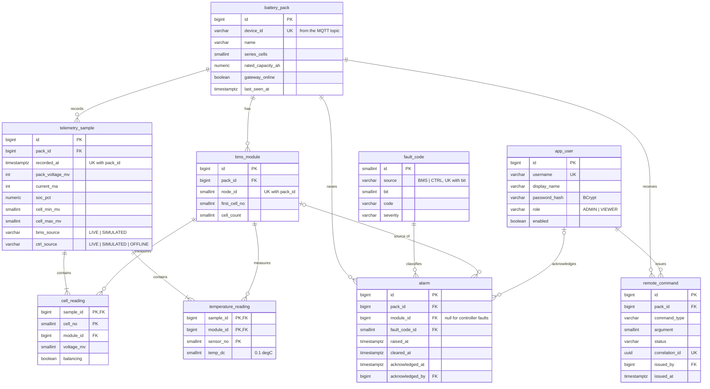

# Database

PostgreSQL 16, schema owned by Flyway (`backend/src/main/resources/db/migration`).
Hibernate only validates the schema at start-up (`ddl-auto: validate`); it never changes it.

## ER diagram

## Why it is shaped like this

- **A pack has modules, a module has cells.** Today there is one master node with 16
  cells, but `bms_module` (node id, first cell number, cell count) lets a larger pack
  with several masters fit without a schema change. Cell numbers are pack-wide.
- **Readings are rows, not array columns.** `cell_reading` and `temperature_reading`
  give "history of cell 7" as a simple indexed query and keep every value checkable.
- **`fault_code` is a lookup table** seeded from the firmware's bit definitions
  (`V2__seed_fault_codes.sql`), so an alarm stores only a reference, and names,
  severities and descriptions live in one place.
- **Integers in firmware units** (mV, mA, 0.1 °C): exact, compact, and identical to
  what crossed the CAN bus.
- **Provenance is stored.** `bms_source` / `ctrl_source` record whether a sample was
  measured or filled in by the gateway, so history can never pass simulated data off
  as real.

## Constraints that protect the data

| Constraint | Protects against |
|---|---|
| `UNIQUE (pack_id, recorded_at)` on `telemetry_sample` | The gateway replays buffered messages after a Wi-Fi outage; `INSERT … ON CONFLICT DO NOTHING` turns a repeat into a no-op |
| `CHECK` ranges on voltages, temperatures, SoC, fan duty, node and cell numbers | Corrupt or mis-decoded values reaching the history |
| `CHECK (cell_max_mv >= cell_min_mv)`, `CHECK (cleared_at >= raised_at)` | Impossible combinations |
| `CHECK ((acknowledged_at IS NULL) = (acknowledged_by IS NULL))` | An acknowledgement without a person, or the other way round |
| Partial unique index `ux_alarm_open` (one open alarm per fault per module) | Duplicate alarms if two messages race |
| `ON DELETE CASCADE` from `battery_pack` | Orphan rows when a pack is removed |

## The transaction

Saving a sample is the one operation that must be all or nothing: the
`telemetry_sample` row, its 16 `cell_reading` rows and its 4 `temperature_reading` rows
are written in a single transaction (`TelemetryStore.save`). If any reading is rejected
by a constraint, the sample row is rolled back too, so a chart never shows a sample
with missing cells. An integration test forces this by inserting an out-of-range cell
voltage and checks that no sample remains.

Command handling is the other place where order matters: the command row is committed
first and published to MQTT only **after** the commit
(`@TransactionalEventListener(AFTER_COMMIT)`), so a command can never reach the pack
without being logged.

## Indexes

Only for queries the application runs:

| Index | Query |
|---|---|
| `telemetry_sample (pack_id, recorded_at)` – from the unique constraint | latest sample, history in a time range, CSV export |
| `cell_reading` primary key `(sample_id, cell_no)` | per-cell history |
| `ux_alarm_open` partial, `WHERE cleared_at IS NULL` | active alarms of a pack (also enforces uniqueness) |
| `ix_alarm_pack_raised (pack_id, raised_at DESC)` | paginated alarm list, newest first |
| `ix_command_pack_issued (pack_id, issued_at DESC)` | command log |
| `ix_command_waiting (issued_at) WHERE status IN ('PENDING','PUBLISHED')` | the timeout job, which only looks at commands still waiting |

## Size and retention

One sample every 10 s is 8 640 samples and about 173 000 reading rows (16 cells + 4 sensors each) per pack per
day. A nightly job deletes samples older than 90 days (`bms.storage.retention-days`);
readings go with them through `ON DELETE CASCADE`. History charts never load raw rows
for long ranges: the query averages into 1-minute or 15-minute buckets with
PostgreSQL's `date_bin`, so a 30-day chart is still about 3 000 points.
